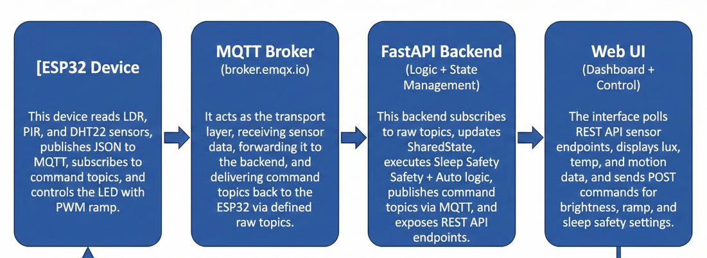
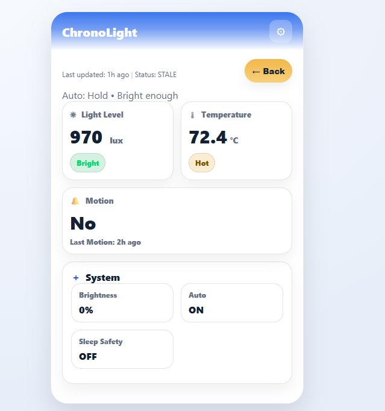
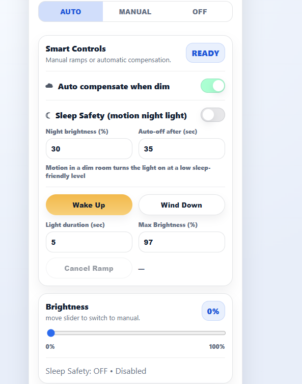

# ChronoLight

Motion-aware, sleep-safe adaptive lighting for nighttime mobility.

## The problem

- Bright light at night disrupts sleep cycles.
- Total darkness increases fall risk, especially for elderly users moving around at night.
- Manual light controls are inconvenient to use in the dark.
- Most lighting systems aren't adaptive enough to solve both problems at once.

## What it does

ChronoLight turns a light on automatically when it detects motion in a dark room, capped at a brightness low enough to stay sleep-safe. It also compensates automatically when ambient light is low, and ramps brightness smoothly for wake-up and wind-down instead of switching on or off abruptly.

- Motion-triggered night lighting, capped at a low, sleep-safe brightness
- Automatic brightness compensation when ambient light is low
- Smooth wake-up and wind-down brightness ramps
- Live monitoring and manual override through a web dashboard

## Hardware

Built and simulated in Wokwi rather than on physical hardware, due to hardware limitations.

- ESP32 microcontroller
- DHT22 temperature and humidity sensor (GPIO26)
- PIR motion sensor (GPIO27)
- LDR ambient light sensor (GPIO34, analog)
- LED with resistor, PWM-controlled (GPIO2)

## Architecture

ESP32 → MQTT broker (broker.emqx.io) → FastAPI backend → web dashboard, with commands flowing back the same path in reverse.

- **ESP32**: reads the three sensors, publishes readings as JSON over MQTT, subscribes to command topics, and drives the LED via PWM.
- **MQTT broker**: transport layer between the device and the backend.
- **FastAPI backend**: owns the decision logic and shared state. Evaluates Sleep Safety rules first, then Auto Compensation. Publishes commands back over MQTT and exposes a REST API for the dashboard.
- **Web dashboard**: polls the REST API, displays lux, temperature, and motion status, and sends brightness, ramp, and sleep-safety settings back to the backend.

## Dashboard

- Light level (lux) and temperature readouts
- Motion status, active or no motion, with last-motion time
- Manual brightness slider, with Auto / Manual / Off modes
- Sleep Safety toggle with adjustable night brightness and auto-off timing
- Wake Up and Wind Down buttons for ramped transitions
- Flags sensor data as stale if the device hasn't reported recently

## Limitations

- Uses fixed thresholds rather than adaptive learning.
- Runs on Wokwi with a simple LED, not a real smart bulb.
- Needs a continuous Wi-Fi and MQTT connection to function.
- Doesn't store sensor history for long-term analysis.
- Built for a single device, no multi-device support yet.

## Possible extensions

- Adaptive thresholds instead of fixed ones.
- Circadian rhythm modelling for biologically aligned transitions.
- Smart bulbs with color temperature control instead of a single LED.
- Local data storage for long-term monitoring.
- Encrypted MQTT and authenticated access.

## Project structure

chronolight/
├── firmware/ # ESP32 code, run in Wokwi
├── backend/ # FastAPI backend: MQTT client, state, REST API
├── dashboard/ # Web UI (HTML/CSS/JS)
└── docs/ # diagrams and screenshots

## Running it

1. Open `firmware/` in Wokwi and start the simulation.
2. Run the backend: `cd backend && pip install -r requirements.txt && python main.py`
3. Open `dashboard/index.html` in a browser, or serve it locally.
4. The dashboard polls the backend, which relays sensor data and commands to and from the ESP32 over MQTT.
